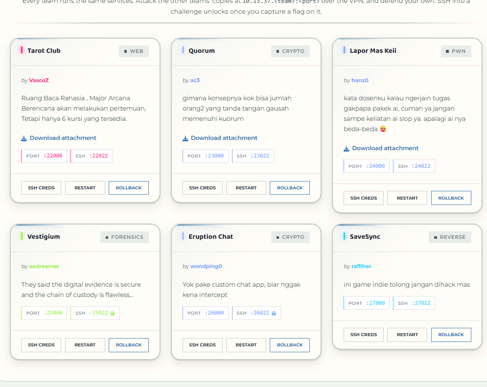

# GEMASTIK XIX finals archive

We manage to solve 4/6 challenges:
lapor-mas-keii, quorum, savesync, tarot-club

`dist` filename is reserved for challenges which provides source code through the AnD platform. Archives w/o `dist` means artifacts are published through the challenge's site itself.

## AI usage
Gemini, no agentic AI. Links to each conversation is provided in the [Write-up](writeup.pdf)

## AnD rules
Access it [here](rules.md).
Disclaimer: not the complete rule.

## Archive Structure
```
challenges
├── lapor-mas-keii # pwn
│   ├── dist
│   └── solve
├── quorum # crypto
│   ├── dist.zip
│   └── solver.py
├── savesync # reverse
│   ├── savesync.apk
│   └── solver.py
├── tarot-club # web
│   ├── dist.zip
│   └── solve.py
└── vestigium # forensics
    └── vestigium-case.zip
```

